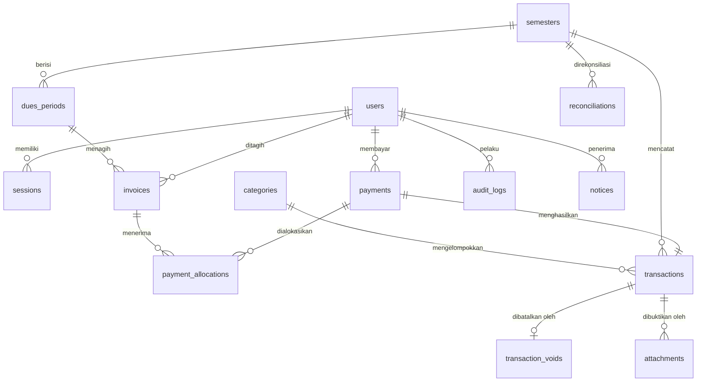

# PRD: Aplikasi Kas Himpunan (PWA)

| | |
|---|---|
| **Versi** | 1.0 |
| **Tanggal** | 16 November 2026 |
| **Pemilik produk** | Barz (Fachri Akbar) |
| **Status** | Final untuk dibangun. Tidak ada keputusan produk yang terbuka; hal teknis yang harus dibuktikan di Fase 0 ada di bagian 16 |
| **Biaya operasional** | Rp 0 (Vercel Hobby, Supabase Free, GitHub Free) |

Dokumen ini adalah satu-satunya sumber kebenaran untuk apa yang dibangun dan mengapa. Setiap butir punya ID agar bisa dirujuk saat implementasi, review kode, dan pengujian. Daftar perubahan dari versi 0.9 ada di bagian 18.

---

## Daftar isi

1. Ringkasan dan tujuan
2. Konteks dan masalah
3. Pengguna, role, dan hak akses
4. Keputusan yang sudah ditetapkan
5. Aturan bisnis
6. Persyaratan fungsional
7. Model data
8. Kontrak API
9. Persyaratan non-fungsional
10. Arsitektur dan struktur kode
11. Spesifikasi UI/UX mobile-first
12. Lingkup PWA
13. Di luar lingkup
14. Risiko dan mitigasi
15. Rencana pengembangan bertahap
16. Asumsi dan verifikasi teknis di Fase 0
17. Pengujian, rilis, operasi, dan pemulihan data
18. Riwayat revisi

---

## 1. Ringkasan dan tujuan

Aplikasi ini adalah **buku kas yang dapat diperiksa oleh seluruh anggota satu angkatan**. Bendahara mencatat, ketua mengawasi dan mengelola akun, anggota membaca. Aplikasi **bukan** sarana pembayaran: uang berpindah di luar aplikasi (tunai atau transfer), aplikasi hanya mencatat dan menampilkannya.

| ID | Tujuan | Ukuran keberhasilan |
|---|---|---|
| G-1 | Setiap anggota tahu status iuran pribadinya kapan saja | Anggota membuka "Kas Saya" dan melihat status per minggu, tunggakan, dan riwayat tanpa bertanya ke bendahara |
| G-2 | Setiap anggota tahu saldo kas dan ke mana uang keluar | Saldo, daftar pengeluaran, urgensi, dan bukti dapat dibuka semua anggota |
| G-3 | Tidak ada perubahan keuangan yang bisa dilakukan diam-diam | 100% aksi tulis tercatat di audit log permanen; baris buku tidak pernah di-UPDATE atau di-DELETE |
| G-4 | Catatan aplikasi cocok dengan uang riil | Rekonsiliasi akhir semester menghasilkan selisih yang tercatat dan terlihat semua anggota |
| G-5 | Mudah dipakai dari HP | Bendahara mencatat satu pembayaran iuran dalam tidak lebih dari 4 langkah ketuk dan ketik |
| G-6 | Berjalan tanpa biaya | Seluruh komponen produksi berada di paket gratis, dengan backup dan pencegah pause yang tidak bergantung pada paket berbayar |

**Skala:** satu angkatan, sekitar 30 orang (kelas reguler dan karyawan), kas kecil per semester, iuran **mingguan** dengan nominal sama untuk semua anggota, bendahara tetap selama 8 semester.

---

## 2. Konteks dan masalah

1. Sulit mengetahui siapa yang sudah dan belum membayar kas.
2. Sulit mengetahui saldo kas saat ini.
3. Sulit mengetahui asal pemasukan.
4. Sulit mengetahui penggunaan uang kas.
5. Anggota hanya tahu saldo akhir, bukan arus kas.
6. Belum ada pencatatan yang bisa diperiksa semua anggota.
7. Perlu kepercayaan antara bendahara, ketua, dan anggota.

Celah yang disadari sejak awal: **aplikasi hanya mencatat apa yang dimasukkan.** Bendahara yang tidak jujur tetap bisa tidak mencatat uang yang masuk. Karena itu kepercayaan dibangun dari kombinasi buku yang tidak bisa diubah, bukti pengeluaran, audit log, dan rekonsiliasi dengan uang riil, bukan dari aplikasinya saja.

---

## 3. Pengguna, role, dan hak akses

Setiap anggota memiliki **satu akun** (username dan password) dengan no. telepon dan email tersimpan di profilnya. Ada tiga role.

| Role | Siapa | Tugas |
|---|---|---|
| `ketua` | Ketua angkatan (admin) | Mengelola akun dan data anggota, mengatur semester, iuran, dan kategori, memeriksa audit log. **Tidak mencatat transaksi.** |
| `bendahara` | Bendahara tetap | Mencatat pembayaran iuran, pemasukan, pengeluaran, bukti, pembatalan, dan rekonsiliasi. |
| `anggota` | Anggota biasa | Membaca. Tidak mengubah apa pun, termasuk data dan password pribadinya. |

### 3.1 Matriks hak akses

`V` = lihat, `C` = buat/catat, `M` = ubah, `—` = tidak ada akses.

| Kemampuan | ketua | bendahara | anggota |
|---|---|---|---|
| Saldo, total pemasukan, total pengeluaran | V | V | V |
| Daftar transaksi: pengeluaran lengkap, iuran agregat per tanggal | V | V | V |
| Iuran per nama anggota (siapa menunggak) | V | V | hanya milik sendiri |
| Jumlah anggota menunggak (angka) | V | V | — |
| "Kas Saya" (status iuran pribadi, dibuka dari Profil bagi ketua dan bendahara) | V | V | V |
| Catat pembayaran iuran | — | C | — |
| Catat pemasukan dan pengeluaran lain | — | C | — |
| Batalkan transaksi atau pembayaran (dengan alasan) | — | C | — |
| Unggah bukti pengeluaran | — | C | — |
| Lihat bukti pengeluaran | V | V | V |
| Rekonsiliasi saldo | V | C | V |
| Kelola data anggota dan password | C, M | — | — |
| Atur semester, periode iuran, kategori | C, M | — | — |
| Audit log permanen | V | — | — |
| Pemberitahuan aktivitas akun sendiri (7 hari) | V | V | V |
| Laporan bulanan | V | V | V |

Prinsip: **deny by default**. Setiap endpoint menolak akses kecuali role-nya diizinkan secara eksplisit.

---

## 4. Keputusan yang sudah ditetapkan

Keputusan di tabel ini tidak diubah tanpa alasan tertulis dan persetujuan pemilik produk.

| ID | Keputusan | Asal |
|---|---|---|
| D-01 | Pembayaran kas terjadi di luar aplikasi: tunai ke bendahara atau transfer | Awal |
| D-02 | Tidak ada payment gateway, QRIS, pilihan metode bayar, upload bukti transfer, atau WhatsApp API | Awal |
| D-03 | Konfirmasi pembayaran lewat WhatsApp ke bendahara; bendahara mencatat setelah uang benar-benar diterima | Awal |
| D-04 | Status tagihan hanya **Belum Bayar** dan **Lunas** | Awal |
| D-05 | Transaksi tidak pernah dihapus; koreksi lewat pembatalan yang meninggalkan riwayat | Awal |
| D-06 **(rev)** | Stack: React + Vite + **TypeScript** + Tailwind; API TypeScript di Vercel Functions; database **Supabase PostgreSQL**. Menggantikan PHP Native OOP + MySQL. Alasan: PHP tidak berjalan di Vercel, dan hosting gratis PHP yang dipertimbangkan (InfinityFree) memblokir akses API dan PWA lewat sistem keamanannya | Diskusi 16 Nov |
| D-07 | Mobile-first dengan bottom navigation, tanpa horizontal scroll | Awal |
| D-08 | Satu angkatan, sekitar 30 orang; kas per semester; tanggal akhir semester diatur ketua | Diskusi |
| D-09 | Bendahara tetap sampai lulus; tidak ada fitur serah terima | Diskusi |
| D-10 | Ketua dapat mengubah nama, no. telepon, email, dan password anggota **tanpa password lama**. Anggota tidak mengubah datanya sendiri | Diskusi |
| D-11 | Ketua tidak mencatat transaksi; tidak ada alur persetujuan koreksi | Diskusi |
| D-12 | Anggota tidak dapat melihat siapa yang belum bayar | Diskusi |
| D-13 | Daftar transaksi untuk anggota: saldo total, iuran tampil agregat per tanggal tanpa nama (contoh: "Iuran kas, 5 anggota, Rp 100.000"), pengeluaran lengkap dengan urgensinya | Diskusi |
| D-14 | Reset password tanpa pengaman tambahan; penggantinya adalah pemberitahuan di akun yang bersangkutan (FR-NTC) | Diskusi |
| D-15 | Pemberitahuan tampil 7 hari lalu hilang dari layar; catatan aslinya tetap permanen di Audit Log yang dibuka ketua | Diskusi |
| D-16 | Log login hanya terlihat oleh pemilik akun yang bersangkutan | Diskusi |
| D-17 | Pembayaran sebagian dicatat sebagai jumlah; tidak ada status "Sebagian" | Diskusi |
| D-18 | Rekonsiliasi dilakukan sekali di akhir semester | Diskusi |
| D-19 | Notifikasi push dan mode offline tidak dimasukkan | Diskusi |
| D-20 | Unduh PDF, laporan tahunan, dan grafik arus kas ditunda ke fase akhir | Diskusi |
| D-21 | UI profesional, tidak bergaya template generik; teks antarmuka ditulis manual | Diskusi |
| D-22 | **Iuran ditagih mingguan, nominal sama** untuk reguler dan karyawan | Diskusi 16 Nov |
| D-23 | **Saldo kas terbawa antar semester**: saldo akhir semester lama menjadi saldo awal semester baru, tanpa mulai dari nol | Diskusi 16 Nov |
| D-24 | Ketua dan bendahara juga melihat status iuran pribadi lewat "Kas Saya" yang dibuka dari Profil | Diskusi 16 Nov |
| D-25 | **Seluruh produksi 100% gratis:** Vercel Hobby, Supabase Free, GitHub Free. Alamat aplikasi memakai subdomain `*.vercel.app` | Diskusi 16 Nov |

---

## 5. Aturan bisnis

Aturan ini adalah invarian sistem. Semuanya ditegakkan di **server** dan, sebisa mungkin, di database.

| ID | Aturan |
|---|---|
| BR-01 | Semua uang disimpan sebagai **bilangan bulat rupiah** (`bigint`). Tidak ada `float`, `numeric` desimal, atau `number` pecahan untuk uang. |
| BR-02 | `Saldo = Saldo awal semester + Σ pemasukan aktif − Σ pengeluaran aktif`. Saldo selalu **dihitung** dari transaksi, tidak pernah disimpan sebagai angka yang bisa diedit. |
| BR-03 | Tabel buku (`transactions`, `transaction_voids`, `payments`, `payment_allocations`, `reconciliations`, `audit_logs`) bersifat **append-only**: tidak ada UPDATE dan DELETE. |
| BR-04 | Membatalkan transaksi berarti menambah satu baris di `transaction_voids` dengan alasan wajib. Transaksi yang dibatalkan tidak dihitung dalam saldo tetapi tetap tampil dengan penanda "Dibatalkan". Transaksi pengganti menunjuk transaksi asal lewat `replaces_id`. |
| BR-05 | Satu pembayaran iuran otomatis membuat satu transaksi pemasukan kategori "Iuran kas" dan satu atau lebih alokasi ke tagihan, **dalam satu transaksi database**. Gagal salah satu, gagal semuanya. |
| BR-06 | Nominal pembayaran dialokasikan otomatis ke tagihan **tertua yang belum lunas** (FIFO). Total pembayaran tidak boleh melebihi total sisa tagihan anggota itu pada semester aktif. Karena semua tagihan mingguan dibuat di awal semester, membayar di muka otomatis mengisi minggu-minggu berikutnya. |
| BR-07 | Pembayaran dan pencatatan transaksi memakai `Idempotency-Key` dari klien, sehingga ketukan ganda atau pengulangan akibat jaringan tidak membuat catatan ganda. Saat mengalokasikan, baris tagihan terkait dikunci (`SELECT ... FOR UPDATE`) agar dua pencatatan serentak tidak melampaui nominal tagihan. |
| BR-08 | Status tagihan **diturunkan**, tidak disimpan: `Lunas` bila total alokasi aktif ≥ nominal tagihan; selain itu `Belum Bayar` dengan sisa ("Kurang Rp 5.000"). "Menunggak" berarti belum lunas dan sudah lewat jatuh tempo; "Belum jatuh tempo" adalah label tampilan, bukan status. |
| BR-09 | Setiap pembayaran menyimpan `received_on` (tanggal uang diterima, diisi bendahara, tidak boleh di masa depan) dan `recorded_at` (waktu pencatatan, diisi server). Selisihnya terlihat. |
| BR-10 | Setiap pengeluaran wajib berisi **keterangan** dan **urgensi**. Bukti bersifat opsional di sistem, tetapi pengeluaran tanpa bukti ditandai "Tanpa bukti" di daftar. |
| BR-11 | Anggota yang berhenti dinonaktifkan, tidak dihapus. Akun nonaktif tidak bisa login dan tidak dihitung dalam angka tunggakan; riwayatnya tetap utuh. |
| BR-12 | Hanya satu semester berstatus aktif pada satu waktu. Transaksi dicatat ke semester aktif dan tanggal kejadiannya (`occurred_on`) tidak boleh sebelum tanggal mulai semester atau di masa depan. Semester ditutup manual oleh ketua, tidak otomatis pada tanggal akhir. |
| BR-13 | Data iuran per nama **tidak pernah dikirim** ke role `anggota` kecuali milik akunnya sendiri. Agregasi dilakukan di server (D-12, D-13). |
| BR-14 | Mengganti password mencabut semua sesi aktif akun itu. |
| BR-15 | Setiap aksi tulis menghasilkan satu baris audit log dengan aktor, waktu, objek, nilai sebelum, nilai sesudah, dan alasan bila ada. |
| BR-16 | Saldo awal semester pertama diisi ketua saat pengaturan awal. Saldo awal semester berikutnya **dihitung otomatis** dari saldo akhir semester sebelumnya saat ditutup (D-23) dan tidak dapat diedit. |

---

## 6. Persyaratan fungsional

Prioritas: **M** = MVP, **L** = fase lanjutan.

### 6.1 Autentikasi dan sesi (AUTH)

| ID | Persyaratan | Kriteria penerimaan | P |
|---|---|---|---|
| AUTH-01 | Login dengan username dan password | Kredensial benar membuat sesi; salah menampilkan pesan umum yang tidak membocorkan mana yang keliru | M |
| AUTH-02 | Logout | Sesi dicabut di database dan cookie dihapus | M |
| AUTH-03 | Pembatasan percobaan login | Lima kegagalan dalam 15 menit pada kombinasi username dan IP menghasilkan respons 429 selama sisa jendela | M |
| AUTH-04 | Sesi kedaluwarsa | Sesi habis setelah 30 hari tanpa aktivitas, atau saat dicabut (BR-14) | M |
| AUTH-05 | Akun nonaktif tidak bisa login | Login ditolak; riwayat tetap ada | M |

Anggota tidak mengganti password sendiri (D-10). Lupa password diselesaikan dengan meminta ketua mengaturnya ulang.

### 6.2 Manajemen anggota (MEM), role `ketua`

| ID | Persyaratan | Kriteria penerimaan | P |
|---|---|---|---|
| MEM-01 | Tambah anggota: username, nama, no. telepon, email, password awal, role | Username unik; tagihan periode yang belum jatuh tempo dibuat otomatis; masuk audit log | M |
| MEM-02 | Ubah nama, no. telepon, email | Perubahan tercatat dengan nilai sebelum dan sesudah | M |
| MEM-03 | Atur password anggota tanpa password lama | Password baru ter-hash; semua sesi akun itu dicabut; pemberitahuan muncul di akun yang diubah (NTC-02) | M |
| MEM-04 | Nonaktifkan dan aktifkan kembali anggota | Tidak ada penghapusan; status tercatat | M |
| MEM-05 | Ubah role | Hanya ketua; tercatat; tidak bisa menurunkan ketua terakhir | M |

### 6.3 Semester, iuran, dan kategori (SET), role `ketua`

| ID | Persyaratan | Kriteria penerimaan | P |
|---|---|---|---|
| SET-01 | Buat dan atur semester: label, tanggal mulai, tanggal akhir, saldo awal (hanya semester pertama, BR-16) | Hanya satu semester aktif; tanggal akhir dapat diubah selama semester aktif | M |
| SET-02 | **Buat deretan periode iuran mingguan** dari tanggal mulai sampai tanggal akhir dengan hari jatuh tempo (misalnya Jumat) dan nominal tunggal | Satu aksi membuat seluruh periode dan tagihan untuk semua anggota aktif, dalam satu transaksi database; hasilnya dapat dipratinjau sebelum disimpan | M |
| SET-03 | Kelola kategori pemasukan dan pengeluaran | Kategori dinonaktifkan, tidak dihapus; "Iuran kas" adalah kategori sistem yang tidak bisa diubah | M |
| SET-04 | Tutup semester dan mulai semester berikutnya | Syarat: rekonsiliasi akhir semester sudah ada. Setelah ditutup tidak ada transaksi baru di semester itu; semester baru mendapat saldo awal otomatis (BR-16) | M |

### 6.4 Pembayaran iuran (PAY), role `bendahara`

| ID | Persyaratan | Kriteria penerimaan | P |
|---|---|---|---|
| PAY-01 | Daftar anggota dengan status iuran dan pencarian nama | Menampilkan nama, ringkasan (lunas sampai minggu berapa, atau jumlah minggu dan rupiah tunggakan); pencarian dan filter berjalan di server | M |
| PAY-02 | Catat pembayaran: pilih anggota, isi nominal dan tanggal diterima | Tanggal bawaan hari ini; sistem **menampilkan pratinjau alokasi** ("Minggu 3 lunas, Minggu 4 kurang Rp 5.000") sebelum simpan; menolak kelebihan (BR-06) | M |
| PAY-03 | Pembayaran sebagian | Alokasi FIFO menyisakan minggu terakhir kurang sekian rupiah; status tagihan itu tetap Belum Bayar | M |
| PAY-04 | Batalkan pembayaran | Membatalkan transaksi terkait dengan alasan wajib; alokasi tidak lagi dihitung; status turunan kembali benar | M |
| PAY-05 | Tunggakan beberapa minggu dan bayar di muka | Satu pembayaran dapat melunasi beberapa minggu sekaligus lewat alokasi otomatis (BR-06); "Kas Saya" menampilkan total tunggakan dan rincian per minggu | M |

### 6.5 Transaksi dan bukti (TRX), role `bendahara` mencatat, semua membaca

| ID | Persyaratan | Kriteria penerimaan | P |
|---|---|---|---|
| TRX-01 | Catat pemasukan non-iuran (dana kegiatan, sumbangan, lainnya) | Kategori, nominal, tanggal, keterangan wajib | M |
| TRX-02 | Catat pengeluaran dengan keterangan dan urgensi wajib | Menolak simpan tanpa keduanya (BR-10) | M |
| TRX-03 | Unggah bukti pengeluaran (foto nota, kuitansi, dokumen) | Memenuhi SEC-12; dapat ditambah setelah transaksi dibuat | M |
| TRX-04 | Daftar transaksi dengan filter bulan | Dikelompokkan per tanggal; pemuatan bertahap; iuran agregat untuk anggota (BR-13) | M |
| TRX-05 | Detail transaksi | Semua field, bukti, status batal, transaksi pengganti, penginput | M |
| TRX-06 | Batalkan transaksi dan buat pengganti | Alasan wajib; transaksi asli tetap terlihat dengan penanda dibatalkan (BR-04) | M |
| TRX-07 | Penanda "Tanpa bukti" pada pengeluaran | Muncul otomatis bila tidak ada lampiran | M |

### 6.6 Kas Saya (DUE), semua role

| ID | Persyaratan | Kriteria penerimaan | P |
|---|---|---|---|
| DUE-01 | Ringkasan status pribadi | "Lunas" (dengan "dibayar sampai Minggu N" bila di muka) atau "Menunggak N minggu, Rp X" | M |
| DUE-02 | Daftar tagihan mingguan | Per minggu: tanggal jatuh tempo, nominal, status Lunas atau Belum Bayar, sisa; minggu yang belum jatuh tempo diberi label sesuai | M |
| DUE-03 | Riwayat pembayaran pribadi | Tanggal diterima, nominal, minggu yang dicakup | M |
| DUE-04 | Panduan konfirmasi | Teks cara konfirmasi ke bendahara dan tautan biasa `wa.me` ke nomor bendahara (bukan integrasi API, sesuai D-02) | M |

### 6.7 Rekonsiliasi (REC)

| ID | Persyaratan | Kriteria penerimaan | P |
|---|---|---|---|
| REC-01 | Bendahara memasukkan saldo riil (tunai dan rekening) di akhir semester | Sistem membandingkan dengan saldo aplikasi dan menyimpan selisih | M |
| REC-02 | Catatan penjelasan selisih | Wajib diisi bila selisih tidak nol | M |
| REC-03 | Hasil terlihat semua anggota | Tampil di Laporan dan Beranda: tanggal, saldo sistem, saldo riil, selisih, catatan | M |
| REC-04 | Rekonsiliasi ulang | Dicatat sebagai baris baru; riwayat sebelumnya tidak diubah | M |

### 6.8 Laporan (RPT)

| ID | Persyaratan | Kriteria penerimaan | P |
|---|---|---|---|
| RPT-01 | Laporan bulanan di layar: saldo awal, total masuk, total keluar, saldo akhir, rincian per kategori | Angka cocok dengan penjumlahan transaksi aktif; iuran agregat untuk anggota | M |
| RPT-02 | Cetak laporan lewat browser (stylesheet cetak) | Hasil cetak satu kolom tanpa elemen navigasi | L |
| RPT-03 | Unduh PDF | Format sama dengan layar | L |
| RPT-04 | Laporan tahunan atau antar semester | Rekap saldo bawaan dan akhir tiap semester | L |
| RPT-05 | Grafik arus kas | Satu grafik sederhana, terbaca di 360 px | L |

### 6.9 Audit log dan pemberitahuan (AUD, NTC)

| ID | Persyaratan | Kriteria penerimaan | P |
|---|---|---|---|
| AUD-01 | Audit log permanen untuk setiap aksi tulis | Aktor, waktu, aksi, objek, nilai sebelum, nilai sesudah, alasan, IP | M |
| AUD-02 | Ketua menelusuri audit log dengan filter aktor, aksi, rentang tanggal | Tidak ada fitur ubah atau hapus log di aplikasi | M |
| NTC-01 | Setiap login berhasil menghasilkan pemberitahuan di akun itu: "Akun ini dibuka pada 16 Nov 2026, 19.42" | Hanya terlihat oleh pemilik akun (D-16) | M |
| NTC-02 | Penggantian password oleh ketua menghasilkan pemberitahuan di akun yang diganti: "Password akun ini diganti oleh ketua pada ..." | Terlihat saat pemilik akun membuka aplikasi | M |
| NTC-03 | Pemberitahuan hanya tampil 7 hari | Query menyaring `created_at` dalam 7 hari; baris lama dibersihkan oleh tugas harian; catatan permanen tetap di audit log (D-15) | M |

---

## 7. Model data

Database: **Supabase PostgreSQL**. Waktu sistem memakai `timestamptz` (UTC), tanggal bisnis memakai `date` menurut kalender WIB (Asia/Jakarta). Semua tabel berada di skema `public` dengan **Row Level Security aktif dan tanpa policy**, sehingga kunci publik Supabase tidak dapat membaca apa pun (SEC-13). Kolom `id` memakai `bigint generated always as identity`.



### 7.1 Tabel

**`users`**

| Kolom | Tipe | Catatan |
|---|---|---|
| id | bigint PK | |
| username | text | UNIQUE, huruf kecil |
| name | text | |
| phone | text | |
| email | text | |
| password_hash | text | Argon2id |
| role | text | CHECK in ('ketua','bendahara','anggota') |
| is_active | boolean | bawaan true |
| created_at, updated_at | timestamptz | |

**`sessions`**

| Kolom | Tipe | Catatan |
|---|---|---|
| id | bigint PK | |
| token_hash | text | SHA-256 dari token acak 32 byte; token mentah hanya ada di cookie |
| csrf_token | text | |
| user_id | FK users | |
| created_at, last_seen_at, expires_at | timestamptz | |
| revoked_at | timestamptz NULL | diisi saat logout atau reset password |
| ip | inet | |

**`semesters`**

| Kolom | Tipe | Catatan |
|---|---|---|
| id | bigint PK | |
| label | text | contoh "Semester 3" |
| start_date, end_date | date | `end_date` dapat diatur ketua |
| opening_balance | bigint | semester pertama: input ketua; berikutnya: dihitung (BR-16) |
| status | text | CHECK in ('active','closed') |
| closed_at | timestamptz NULL | |
| | | Indeks unik parsial: hanya satu baris `status='active'` |

**`dues_periods`**: satu baris per minggu.

| Kolom | Tipe | Catatan |
|---|---|---|
| id | bigint PK | |
| semester_id | FK | |
| week_no | int | urutan minggu dalam semester |
| label | text | "Minggu 3 (17-23 Nov)" |
| due_date | date | |
| default_amount | bigint | CHECK > 0 |
| | | UNIQUE (semester_id, week_no) |

**`invoices`**: tagihan per anggota per minggu.

| Kolom | Tipe | Catatan |
|---|---|---|
| id | bigint PK | |
| period_id | FK dues_periods | |
| user_id | FK users | |
| amount_due | bigint | disimpan per tagihan agar fleksibel (FLX-02) |
| | | UNIQUE (period_id, user_id) |

**`categories`**

| Kolom | Tipe | Catatan |
|---|---|---|
| id | bigint PK | |
| kind | text | CHECK in ('in','out') |
| name | text | UNIQUE (kind, name) |
| is_system | boolean | "Iuran kas" = true |
| is_active | boolean | |

**`transactions`**: buku besar, append-only.

| Kolom | Tipe | Catatan |
|---|---|---|
| id | bigint PK | |
| semester_id | FK | |
| kind | text | CHECK in ('in','out') |
| category_id | FK | |
| amount | bigint | CHECK > 0 |
| occurred_on | date | |
| description | text | wajib |
| urgency | text NULL | CHECK: wajib bila `kind='out'` |
| replaces_id | FK transactions NULL | |
| idempotency_key | uuid NULL | UNIQUE |
| created_by | FK users | |
| created_at | timestamptz | |

**`transaction_voids`**

| Kolom | Tipe | Catatan |
|---|---|---|
| transaction_id | PK, FK transactions | satu pembatalan per transaksi |
| reason | text | wajib |
| voided_by | FK users | |
| voided_at | timestamptz | |

**`payments`**: satu baris per kejadian pembayaran.

| Kolom | Tipe | Catatan |
|---|---|---|
| id | bigint PK | |
| user_id | FK users | pembayar |
| amount | bigint | CHECK > 0 |
| received_on | date | tanggal uang diterima |
| transaction_id | FK transactions | UNIQUE; 1 pembayaran = 1 transaksi |
| idempotency_key | uuid | UNIQUE |
| recorded_by | FK users | |
| recorded_at | timestamptz | |

**`payment_allocations`**: ke tagihan mana uang itu terpakai.

| Kolom | Tipe | Catatan |
|---|---|---|
| id | bigint PK | |
| payment_id | FK payments | |
| invoice_id | FK invoices | |
| amount | bigint | CHECK > 0 |
| | | Constraint trigger tertunda (`DEFERRABLE INITIALLY DEFERRED`): `Σ amount` per `payment_id` harus sama dengan `payments.amount` saat commit |

Pembayaran dan alokasinya dianggap aktif selama `transaction_id`-nya tidak ada di `transaction_voids`.

**`attachments`**

| Kolom | Tipe | Catatan |
|---|---|---|
| id | bigint PK | |
| transaction_id | FK | |
| object_path | text | path acak di bucket privat |
| original_name | text | hanya untuk tampilan |
| mime | text | hasil deteksi server |
| size_bytes | int | |
| sha256 | text | |
| uploaded_by, uploaded_at | FK, timestamptz | |

**`reconciliations`**

| Kolom | Tipe | Catatan |
|---|---|---|
| id | bigint PK | |
| semester_id | FK | |
| system_balance | bigint | dihitung server saat disimpan |
| cash_counted, bank_counted | bigint | |
| difference | bigint | generated: `cash_counted + bank_counted - system_balance` |
| note | text NULL | CHECK: wajib bila `difference <> 0` |
| created_by, created_at | FK, timestamptz | |

**`audit_logs`**: permanen.

| Kolom | Tipe | Catatan |
|---|---|---|
| id | bigint PK | |
| actor_id | FK users | |
| action | text | contoh `payment.create`, `user.password_reset` |
| entity_type, entity_id | text, bigint | |
| before_json, after_json | jsonb NULL | password dan hash tidak pernah dimasukkan |
| reason | text NULL | |
| ip | inet | |
| created_at | timestamptz | |

**`notices`**: pemberitahuan layar 7 hari (user_id, kind, message, created_at). **`login_attempts`**: untuk pembatasan login (username, ip, attempted_at, success).

### 7.2 Indeks yang wajib

`transactions (semester_id, occurred_on, id)`, `transactions (category_id)`, `payments (user_id, received_on)`, `payments (received_on)`, `payment_allocations (invoice_id)`, `payment_allocations (payment_id)`, `invoices (user_id)`, `invoices (period_id)`, `dues_periods (semester_id, due_date)`, `sessions (token_hash)` unik, `sessions (user_id)`, `audit_logs (created_at)`, `audit_logs (actor_id, created_at)`, `notices (user_id, created_at)`, `login_attempts (username, ip, attempted_at)`.

### 7.3 Penegakan append-only di database (berlapis)

1. **Hak akses.** Aplikasi tersambung memakai role database khusus (`app_backend`) yang hanya diberi `SELECT, INSERT` pada tabel BR-03, tanpa `UPDATE` dan `DELETE`. Role superuser tidak dipakai aplikasi.
2. **Trigger.** `BEFORE UPDATE` dan `BEFORE DELETE` pada tabel yang sama memanggil `RAISE EXCEPTION`. Trigger tetap melindungi bila hak akses suatu saat longgar.
3. **Repository.** Tidak ada fungsi update atau delete untuk tabel tersebut di kode.
4. Bila role kustom ternyata tidak dapat dipakai lewat pooler Supabase (diverifikasi di Fase 0, V-3), lapisan 2 dan 3 tetap berlaku dan keterbatasan itu dicatat.

---

## 8. Kontrak API

REST, JSON, awalan `/api/v1`. Frontend dan API berada di **satu origin** (Vercel), sehingga tidak ada CORS.

**Konvensi**

- Sukses: `{ "data": ..., "meta": ... }`. Gagal: `{ "error": { "code": "PAYMENT_EXCEEDS_DUE", "message": "...", "fields": { ... } } }`.
- Kode status: `200/201`, `401` (belum login), `403` (role tidak boleh), `404`, `409` (konflik, termasuk idempotency), `422` (validasi), `429` (pembatasan).
- Daftar memakai `limit` (bawaan 20, maksimum 100) dan `cursor` (keyset pada `id`), bukan `OFFSET`.
- `POST` yang membuat catatan keuangan wajib menyertakan header `Idempotency-Key` (UUID).
- Semua `POST/PATCH` wajib menyertakan header `X-CSRF-Token`.
- Uang di JSON selalu integer rupiah. Tanggal bisnis `YYYY-MM-DD`; waktu sistem ISO 8601 UTC.
- Skema validasi input (zod) dibagi antara frontend dan backend lewat folder `shared/`.

| Metode dan path | Role | Fungsi |
|---|---|---|
| `POST /auth/login` | publik | Login |
| `POST /auth/logout` | semua | Logout |
| `GET /auth/me` | semua | Profil sesi, token CSRF, daftar permission untuk UI |
| `GET /me/dues` | semua | Tagihan mingguan, tunggakan, riwayat pembayaran milik sendiri |
| `GET /me/notices` | semua | Pemberitahuan 7 hari terakhir |
| `GET /summary` | semua | Saldo, total masuk, total keluar. Untuk `ketua` dan `bendahara` ditambah jumlah anggota menunggak |
| `GET /transactions` | semua | Daftar transaksi; isi disesuaikan role (BR-13) |
| `GET /transactions/{id}` | semua | Detail transaksi |
| `POST /transactions` | bendahara | Catat pemasukan non-iuran atau pengeluaran |
| `POST /transactions/{id}/void` | bendahara | Batalkan dengan alasan |
| `POST /transactions/{id}/attachments` | bendahara | Unggah bukti |
| `GET /attachments/{id}` | semua | Pemeriksaan sesi lalu pengalihan (302) ke URL bertanda tangan berumur singkat |
| `GET /members/{id}/dues` | bendahara, ketua | Tagihan satu anggota |
| `GET /dues-overview` | bendahara, ketua | Daftar anggota dengan ringkasan iuran dan pencarian nama |
| `POST /payments/preview` | bendahara | Pratinjau alokasi tanpa menyimpan |
| `POST /payments` | bendahara | Catat pembayaran (dengan alokasi FIFO) |
| `GET /reports/monthly?month=YYYY-MM` | semua | Laporan bulanan |
| `GET /reconciliations` | semua | Riwayat rekonsiliasi |
| `POST /reconciliations` | bendahara | Simpan rekonsiliasi |
| `GET /members`, `POST /members` | ketua | Daftar, tambah anggota |
| `PATCH /members/{id}` | ketua | Ubah data anggota |
| `POST /members/{id}/password` | ketua | Atur password baru |
| `POST /members/{id}/deactivate`, `/activate` | ketua | Nonaktifkan, aktifkan |
| `GET /semesters`, `POST /semesters`, `PATCH /semesters/{id}`, `POST /semesters/{id}/close` | ketua (GET: semua) | Kelola semester |
| `POST /dues-periods/generate` | ketua | Buat deretan periode mingguan dan tagihannya (mendukung `dryRun`) |
| `GET /dues-periods` | ketua, bendahara | Daftar periode |
| `GET /categories`, `POST /categories`, `PATCH /categories/{id}` | ketua (GET: semua) | Kelola kategori |
| `GET /audit-logs` | ketua | Telusuri audit log |
| `GET /cron/daily` | hanya Vercel Cron | Tugas harian (lihat 17.3); ditolak tanpa `CRON_SECRET` |

---

## 9. Persyaratan non-fungsional

Empat sifat kode yang menjadi acuan review: **mudah dipelihara, fleksibel, cepat, aman.**

### 9.1 Keamanan (SEC)

| ID | Persyaratan |
|---|---|
| SEC-01 | HTTPS wajib dan otomatis dari Vercel; header HSTS aktif. |
| SEC-02 | Password di-hash dengan Argon2id (`@node-rs/argon2`; bila bermasalah di runtime Vercel, fallback `bcryptjs` cost ≥ 12); panjang minimal 8 karakter. Password tidak pernah dicatat di log, audit log, atau respons. |
| SEC-03 | Cookie sesi `__Host-sid`: `HttpOnly`, `Secure`, `SameSite=Lax`, `Path=/`, tanpa `Domain`. Token acak 32 byte; yang disimpan di database hanya hash-nya. Masa berlaku bergeser (sliding) 30 hari, dan pembaruan `last_seen_at` dibatasi satu kali per jam. |
| SEC-04 | Perlindungan CSRF berlapis: pemeriksaan header `Origin` terhadap host aplikasi pada semua metode non-GET, ditambah token `X-CSRF-Token` per sesi. |
| SEC-05 | Semua query memakai parameter (tagged template `postgres`). Tidak ada penyambungan string ke SQL; `sql.unsafe` dilarang lewat aturan lint. |
| SEC-06 | Otorisasi di server pada setiap endpoint, deny by default, dari satu peta permission. Pemeriksaan tingkat objek: anggota hanya membaca tagihan miliknya. UI yang menyembunyikan tombol bukan kontrol keamanan. |
| SEC-07 | Validasi seluruh input dengan zod (tipe, panjang, rentang) sebelum menyentuh service. Respons error tidak membocorkan detail internal. |
| SEC-08 | Output React di-escape secara bawaan; `dangerouslySetInnerHTML` dilarang. |
| SEC-09 | Header lewat `vercel.json`: `Content-Security-Policy` ketat (`script-src 'self'`, tanpa inline script, `frame-ancestors 'none'`), `X-Content-Type-Options: nosniff`, `Referrer-Policy: same-origin`, `Permissions-Policy` minimal. |
| SEC-10 | Pembatasan percobaan login berbasis tabel `login_attempts` (AUTH-03), karena fungsi serverless tidak menyimpan memori antar permintaan. |
| SEC-11 | Rahasia (URL database, kunci Supabase, `CRON_SECRET`, passphrase backup) hanya di variabel lingkungan Vercel dan GitHub Secrets, dipisah per lingkungan, tanpa awalan yang diekspos ke browser. |
| SEC-12 | Unggahan bukti: tipe diverifikasi dari isi berkas (magic bytes), bukan ekstensi; hanya JPEG, PNG, WebP, PDF; maksimum **4 MB** (batas body fungsi Vercel 4,5 MB); nama objek acak; bucket **privat**; akses lewat URL bertanda tangan berumur ≤ 60 detik setelah pemeriksaan sesi. |
| SEC-13 | Pengerasan Supabase: RLS aktif tanpa policy pada seluruh tabel; Data API dimatikan atau tidak dipakai; **frontend tidak memuat kunci Supabase apa pun** dan tidak memakai `supabase-js`. |
| SEC-14 | Dependensi dijaga minimal; lockfile di-commit; `npm audit` di CI; Dependabot aktif. |
| SEC-15 | Backup dienkripsi sebelum disimpan (17.4). |
| SEC-16 | Autentikasi dua langkah (2FA) aktif pada akun GitHub, Vercel, dan Supabase pemilik. Hanya pemilik yang memegang akses dasbor. |
| SEC-17 | Lingkungan Preview Vercel memakai proyek Supabase **pengembangan**, tidak pernah database produksi. |

### 9.2 Performa (PERF)

Target untuk skala ini (sekitar 30 pengguna), bukan klaim.

| ID | Target |
|---|---|
| PERF-01 | Waktu respons API p95 ≤ 300 ms saat fungsi sudah hangat dan berada di region yang sama dengan database; sesekali cold start ≤ 2 detik dapat diterima. |
| PERF-02 | JavaScript awal ≤ 170 KB setelah gzip; rute dipecah (`lazy`) per fitur. |
| PERF-03 | LCP ≤ 2,5 detik pada HP kelas menengah dengan koneksi 4G. |
| PERF-04 | Foto bukti dikompres di klien sebelum unggah (sisi terpanjang ≤ 1600 px, target ≤ 800 KB). |
| PERF-05 | Tidak ada pola N+1; ringkasan dan laporan dihitung dengan satu-dua query teragregasi yang memakai indeks 7.2. |
| PERF-06 | Daftar besar dipaginasi dengan keyset. |
| PERF-07 | Koneksi database lewat pooler mode transaksi, maksimal 1 koneksi per instans fungsi, `prepare: false`. |
| PERF-08 | Supabase dan fungsi Vercel berada di region yang berdekatan (Singapura) bila paket mengizinkan (V-1). |

### 9.3 Mudah dipelihara (MNT)

| ID | Persyaratan |
|---|---|
| MNT-01 | Backend berlapis tegas per modul: route (tipis) → service (aturan bisnis) → repository (satu-satunya tempat SQL). Route tidak berisi SQL; repository tidak berisi aturan bisnis. |
| MNT-02 | TypeScript `strict`, tanpa `any` eksplisit; ESLint dan Prettier; `tsc --noEmit` wajib lulus di CI. |
| MNT-03 | Frontend disusun per fitur (`features/`), komponen UI primitif dipakai ulang, tidak ada logika bisnis duplikat. |
| MNT-04 | Skema dikelola lewat berkas migrasi SQL bernomor yang dapat dijalankan ulang di database kosong. |
| MNT-05 | Satu README menjelaskan cara menjalankan lokal di Windows 11 dan VS Code, variabel lingkungan, membuat akun ketua pertama, backup, dan pemulihan. |
| MNT-06 | Komentar menjelaskan **alasan**, bukan mengulang kode. Satu konvensi penamaan konsisten. |
| MNT-07 | Satu sumber kebenaran per aturan: perhitungan saldo hanya di `BalanceCalculator`, alokasi FIFO hanya di `AllocationService`, peta permission hanya di satu berkas. |
| MNT-08 | Tipe `Money` bertanda (branded integer) membungkus semua nilai rupiah. |

### 9.4 Fleksibel (FLX)

| ID | Persyaratan |
|---|---|
| FLX-01 | Periode iuran, nominal, kategori, dan tanggal semester disimpan sebagai data yang diatur ketua, tidak ditulis keras di kode. |
| FLX-02 | Nominal disimpan per tagihan (`invoices.amount_due`), sehingga skema iuran lain di masa depan hanya soal isi data. |
| FLX-03 | Hak akses dikelola lewat satu peta permission; menggeser kewenangan tidak menyentuh banyak route. |
| FLX-04 | API berversi (`/v1`); format error dan paginasi seragam. |
| FLX-05 | Konfigurasi (URL, zona waktu, batas) dari variabel lingkungan, bukan kode. |
| FLX-06 | Akses data terisolasi di lapisan repository sehingga database dapat dipindah ke Postgres lain tanpa mengubah service. |

### 9.5 Lain-lain

| ID | Persyaratan |
|---|---|
| NFR-01 | Aksesibilitas: kontras WCAG AA (≥ 4,5:1), area sentuh ≥ 44 × 44 px, semua kontrol berlabel, status tidak mengandalkan warna saja. |
| NFR-02 | Kompatibilitas: Chrome dan Safari (iOS 16+) dua versi terakhir, browser Android modern. |
| NFR-03 | Ketersediaan: tidak ada SLA formal. Target praktis: dapat dipulihkan dari backup terakhir dengan kehilangan data maksimal 24 jam. |
| NFR-04 | Log runtime Vercel Hobby berumur sangat singkat. Kejadian penting (gagal login, aksi tulis) dicatat di tabel database, tidak mengandalkan log runtime. |

---

## 10. Arsitektur dan struktur kode

```
Browser (PWA, React + TS)
        │  HTTPS, satu origin (*.vercel.app)
        ▼
Vercel: berkas statis (Vite build)  +  Vercel Functions (Node, TypeScript) di /api/v1/*
        │                                         │
        │                                         ├── Postgres (Supabase) lewat pooler transaksi
        │                                         └── Supabase Storage (bucket privat) untuk bukti
        └── Vercel Cron harian ──▶ /api/v1/cron/daily
GitHub Actions (terjadwal) ──▶ pg_dump terenkripsi ──▶ penyimpanan backup
```

```
kas-himpunan/
├── api/
│   └── [...route].ts            # entry tunggal; meneruskan ke aplikasi router
├── server/
│   ├── http/                    # aplikasi router, middleware: auth, csrf, can, rateLimit, errorHandler
│   ├── modules/
│   │   ├── auth/  members/  semesters/  dues/  payments/  transactions/
│   │   ├── attachments/  reconciliations/  reports/  audit/  notices/
│   │   └── (tiap modul: routes.ts, service.ts, repository.ts, schema.ts)
│   ├── domain/                  # money.ts, balance.ts, allocation.ts, roles.ts, permissions.ts, errors.ts
│   ├── db/                      # client.ts, withTransaction.ts, migrate.ts
│   └── support/                 # config.ts, clock.ts, logger.ts, password.ts
├── db/
│   ├── migrations/              # 0001_init.sql, 0002_...
│   └── seed/                    # skrip membuat akun ketua pertama
├── shared/                      # skema zod dan tipe yang dipakai frontend dan backend
├── src/                         # frontend
│   ├── app/                     # router, provider, layout, penjaga role
│   ├── features/                # auth, dashboard, dues, payments, transactions,
│   │                            # reports, reconciliation, members, audit, settings
│   ├── components/              # Button, Field, MoneyInput, ListRow, BottomNav, EmptyState
│   ├── lib/                     # api client, format rupiah dan tanggal, peta permission
│   └── styles/
├── tests/
├── .github/workflows/           # ci.yml, backup.yml
├── vercel.json
└── package.json
```

**Keputusan arsitektur**

| ID | Keputusan | Alasan |
|---|---|---|
| AR-01 | Satu fungsi Vercel dengan router ringan (Hono) di dalamnya | Satu bundle, satu cold start, routing dan middleware terpusat; router dapat diganti tanpa menyentuh service |
| AR-02 | Driver `postgres` langsung ke Postgres lewat pooler, bukan REST bawaan Supabase | Transaksi multi-pernyataan yang atomik (BR-05) tidak dapat dilakukan lewat REST Supabase |
| AR-03 | Autentikasi buatan sendiri, bukan Supabase Auth | Aplikasi memakai username, password diatur ketua, tanpa pendaftaran atau reset lewat email; Supabase Auth tidak menambah nilai dan menambah ketergantungan |
| AR-04 | Satu use case = satu method service = satu transaksi database | Menjamin BR-05 |
| AR-05 | `Clock` diinjeksikan, tidak memanggil `Date.now()` langsung | Jatuh tempo, "hari ini" menurut WIB, dan jendela 7 hari dapat diuji |
| AR-06 | Peta permission di satu berkas dalam `shared/`, dikirim ke klien lewat `/auth/me` | Satu sumber kebenaran; UI hanya mengikuti |
| AR-07 | Perhitungan saldo hanya di `BalanceCalculator`; alokasi hanya di `AllocationService` | MNT-07 |
| AR-08 | Dependensi runtime dibatasi: `hono`, `postgres`, `zod`, `@node-rs/argon2`, `@supabase/supabase-js` (hanya di server, hanya untuk Storage) | SEC-14 |

**Alternatif yang dipertimbangkan**

| Alternatif | Hasil |
|---|---|
| PHP + MySQL di InfinityFree | Ditolak. Sistem keamanan browser mereka memblokir akses API dan mencantumkan PWA sebagai tidak didukung; tidak ada SSH dan cron di paket gratis |
| PHP + MySQL di hosting berbayar murah | Tidak dipilih karena tidak memenuhi D-25 (gratis) |
| **Vercel + Supabase (TypeScript)** | **Dipilih** (D-06, D-25) |

---

## 11. Spesifikasi UI/UX mobile-first

### 11.1 Prinsip

1. Dirancang untuk 360, 375, 390, dan 430 px lebih dulu; tampilan lebih lebar adalah pelebaran dari desain ini. Pada ≥ 1024 px bottom navigation berpindah ke rel samping dan konten dibatasi lebar bacanya.
2. Tidak ada horizontal scroll pada halaman mana pun.
3. **Satu elemen dominan per layar.** Di Beranda itu saldo kas.
4. Daftar dengan garis pemisah tipis lebih diutamakan daripada tumpukan kartu. Kartu dipakai hanya bila mengelompokkan satu objek.
5. Satu warna aksen di atas latar putih atau abu sangat terang. Tanpa gradasi, tanpa efek kaca, tanpa ikon di lingkaran berwarna, tanpa emoji sebagai ikon, tanpa deretan kotak statistik berukuran sama.
6. Satu keluarga huruf sans-serif, empat sampai lima ukuran. Angka uang memakai angka tabular agar sejajar.
7. Input teks minimal 16 px agar iOS tidak memperbesar halaman saat fokus.
8. Status tidak bergantung pada warna: selalu ada teks "Lunas" atau "Belum bayar".
9. Teks antarmuka ditulis sebagai bahasa sehari-hari yang konkret: "Lunas sampai Minggu 12", "Menunggak 2 minggu, Rp 40.000", "Belum ada pengeluaran bulan ini", bukan "Pembayaran Anda telah berhasil diverifikasi". Setiap label, pesan kosong, dan pesan error ditulis tangan.
10. Setiap layar punya keadaan kosong, memuat (kerangka sederhana), dan galat yang bisa dipahami orang awam, dengan tindakan lanjutan yang jelas. Saat tidak ada koneksi, aplikasi menampilkan pesan jelas dan tidak menampilkan data lama (D-19).

### 11.2 Navigasi

Bottom navigation, maksimal lima item, ikon dengan label selalu terlihat, area sentuh ≥ 44 px, memperhitungkan safe-area.

| Role | Item |
|---|---|
| anggota | Beranda · Kas Saya · Transaksi · Laporan · Profil |
| bendahara | Beranda · Pembayaran · Transaksi · Laporan · Profil |
| ketua | Beranda · Keuangan · Anggota · Audit Log · Lainnya |

"Keuangan" milik ketua memuat transaksi, laporan, dan rekonsiliasi (hanya baca). "Lainnya" memuat Pengaturan (semester, periode iuran, kategori) dan Profil. Bagi ketua dan bendahara, "Kas Saya" dibuka dari Profil (D-24). Bukti transaksi tidak menjadi menu terpisah; ia melekat pada detail transaksi.

### 11.3 Isi Beranda per role

- **Anggota:** saldo kas (angka besar) → status iuran saya → pemberitahuan akun (bila ada, 7 hari) → lima transaksi terakhir. Hasil rekonsiliasi terakhir muncul sebagai satu baris.
- **Bendahara:** saldo → jumlah anggota menunggak (dapat diketuk menuju daftar) → dua tombol aksi: *Catat pembayaran* dan *Catat pengeluaran* → pemberitahuan akun → transaksi terakhir.
- **Ketua:** saldo → status rekonsiliasi terakhir → aktivitas penting terbaru (pembatalan transaksi, penggantian password) → pemberitahuan akun.

### 11.4 Sketsa layar utama (kerangka, bukan desain visual akhir)

**Beranda anggota**

```
┌────────────────────────────┐
│ Kas Angkatan               │
│                            │
│ Saldo kas                  │
│ Rp 2.450.000               │
│ Masuk Rp 3.000.000         │
│ Keluar Rp 550.000          │
│────────────────────────────│
│ Iuran saya                 │
│ Lunas sampai Minggu 12     │
│────────────────────────────│
│ Transaksi terakhir         │
│ 14 Nov                     │
│  Konsumsi rapat    −85.000 │
│  Iuran kas, 5 ang. +100.000│
│ ...                        │
├────────────────────────────┤
│ Beranda Kas Transaksi ...  │
└────────────────────────────┘
```

**Catat pembayaran (bendahara)**

```
┌────────────────────────────┐
│ ←  Catat pembayaran        │
│                            │
│ Anggota                    │
│ [ cari nama...           ] │
│ Nominal                    │
│ [ Rp 50.000              ] │
│ Tanggal diterima           │
│ [ 16 Nov 2026          ▾ ] │
│                            │
│ Akan melunasi:             │
│  Minggu 3   Rp 20.000      │
│  Minggu 4   Rp 20.000      │
│  Minggu 5   Rp 10.000      │
│             (kurang 10.000)│
│                            │
│ [        Simpan          ] │
└────────────────────────────┘
```

**Kas Saya:** ringkasan status di atas, lalu daftar minggu (jatuh tempo, nominal, Lunas atau Belum bayar dengan sisa), lalu riwayat pembayaran, lalu panduan konfirmasi dengan satu tombol tautan ke WhatsApp bendahara.

**Daftar transaksi:** dikelompokkan per tanggal, satu baris per transaksi (kategori, keterangan singkat, nominal). Pemasukan "+", pengeluaran "−". Pengeluaran tanpa bukti diberi teks kecil "Tanpa bukti". Transaksi dibatalkan tampil dicoret dengan keterangan "Dibatalkan". Ketuk baris membuka detail.

### 11.5 Formulir

Satu kolom, label di atas kolom. Nominal memakai papan angka dan diformat otomatis ("Rp 150.000"). Tanggal bawaan hari ini. Tombol simpan di bagian bawah, mudah dijangkau jempol, dinonaktifkan selama permintaan berjalan (melengkapi `Idempotency-Key`). Kesalahan tampil di dekat kolom bermasalah.

### 11.6 Pengujian tampilan

Diperiksa di lebar 360 px, dengan ukuran teks sistem diperbesar, pada iOS Safari dan Chrome Android, dan pada koneksi lambat.

---

## 12. Lingkup PWA

**Termasuk:** Web App Manifest (nama, ikon 192 dan 512 px termasuk maskable, `display: standalone`, warna tema), dapat dipasang di layar utama, service worker yang hanya meng-cache aset statis hasil build (dibuat dengan `vite-plugin-pwa`, pembaruan otomatis), HTTPS dari Vercel.

**Tidak termasuk (D-19):**

- Mode offline. Respons API **tidak pernah** di-cache; data keuangan selalu diambil dari server.
- Notifikasi push. Aplikasi tidak meminta izin notifikasi.

**Header cache di `vercel.json`:** `/index.html` dan `/sw.js` dengan `Cache-Control: no-cache`; `/assets/*` dengan `immutable` dan umur panjang (nama berkas berhash). Ini mencegah service worker atau halaman versi lama bertahan setelah rilis.

---

## 13. Di luar lingkup

- Payment gateway, QRIS, upload bukti transfer, WhatsApp API, pembayaran otomatis.
- Notifikasi push dan mode offline.
- Serah terima bendahara.
- Pengubahan data atau password oleh anggota sendiri.
- Alur persetujuan koreksi oleh ketua.
- Banyak organisasi atau banyak angkatan dalam satu instalasi.
- Integrasi dengan sistem akuntansi lain.
- Domain khusus berbayar.
- Perubahan nominal iuran di tengah semester (lihat A-7).

---

## 14. Risiko dan mitigasi

| # | Risiko | Mitigasi |
|---|---|---|
| R-1 | Bendahara tidak mencatat uang masuk atau mencatat pengeluaran fiktif | Buku append-only, bukti, penanda "Tanpa bukti", audit log permanen, rekonsiliasi akhir semester yang terlihat semua anggota |
| R-2 | Ketua mengatur ulang password bendahara lalu bertindak sebagai bendahara | Diterima sebagai konsekuensi D-10 dan D-14. Dikurangi oleh pemberitahuan di akun bendahara, pencabutan sesi lama, dan catatan permanen di Audit Log atas nama ketua |
| R-3 | Anggota menyimpulkan siapa yang menunggak dari data agregat | Agregasi di server (BR-13); iuran tampil per tanggal tanpa nama; endpoint anggota tidak pernah mengembalikan baris per nama |
| R-4 | Uang diterima tetapi tertunda dicatat | `received_on` dan `recorded_at` terpisah; kesepakatan batas pencatatan (usulan 2 × 24 jam) di luar aplikasi |
| R-5 | Proyek Supabase gratis di-pause karena sepi aktivitas (misalnya libur semester) | Tugas harian Vercel Cron menjalankan query ringan (17.3); dokumentasi Supabase menyebut beberapa permintaan per hari umumnya cukup |
| R-6 | Tidak ada backup otomatis di paket gratis Supabase | Backup buatan sendiri lewat GitHub Actions, terenkripsi, dan uji pemulihan (17.4) |
| R-7 | Pengembang tunggal | MNT-01 sampai MNT-08, README, migrasi bernomor, CI |
| R-8 | Aplikasi tidak dipakai karena merepotkan bendahara | Target G-5, nominal dan tanggal bawaan, pratinjau alokasi otomatis, pencarian nama |
| R-9 | Kebocoran bukti transaksi | SEC-12 dan SEC-13: bucket privat, URL bertanda tangan berumur singkat |
| R-10 | Service worker menyajikan versi lama | Bagian 12 |
| R-11 | Syarat atau batas paket gratis Vercel atau Supabase berubah | Periksa halaman harga dan dokumentasi resmi di awal Fase 0 dan di akhir tiap semester; Postgres standar sehingga pindah penyedia dimungkinkan (FLX-06) |
| R-12 | Data uji dan data produksi tercampur | SEC-17: Preview dan pengembangan memakai proyek Supabase terpisah, variabel lingkungan dipisah per lingkungan |
| R-13 | Workflow backup berhenti diam-diam | GitHub mengirim email saat workflow gagal; pemilik memeriksa riwayat workflow setiap akhir bulan; uji pemulihan terjadwal tiap akhir semester |
| R-14 | Data pribadi 30 anggota (no. telepon, email) berada di layanan pihak ketiga | Data minimal; 2FA di semua akun layanan (SEC-16); RLS aktif dan tanpa kunci Supabase di klien |
| R-15 | Penggunaan Hobby Vercel di luar syarat non-komersial | Kas angkatan bukan penggunaan komersial; bila sifat penggunaan berubah, tinjau ulang syaratnya |

---

## 15. Rencana pengembangan bertahap

| Fase | Isi | Kriteria selesai |
|---|---|---|
| **0. Fondasi dan pembuktian teknis** | Akun GitHub, Vercel, Supabase dengan 2FA; repositori, CI, lingkungan dev dan produksi; migrasi `0001`; **spike** untuk V-1 sampai V-5 (bagian 16); desain 360 px untuk Beranda, Kas Saya, Catat pembayaran, Daftar transaksi | Semua V-1 sampai V-5 terbukti atau punya jalan keluar tercatat; desain disetujui; deploy "hello" end-to-end berjalan |
| **1. Inti buku kas** | Autentikasi dan sesi, manajemen anggota, semester, periode mingguan, tagihan, pembayaran dengan alokasi, transaksi, pembatalan, audit log, pemberitahuan, Kas Saya, Beranda dasar per role, workflow backup | Semua FR berprioritas M di 6.1 sampai 6.6 lulus kriteria penerimaan; uji otorisasi per endpoint per role lulus; saldo dan alokasi cocok dengan data uji; backup berjalan dan **uji pemulihan** berhasil |
| **2. Kepercayaan** | Bukti pengeluaran, rekonsiliasi, penutupan semester, laporan bulanan, Beranda final per role, PWA dapat dipasang, tugas harian (pencegah pause dan pembersihan) | TRX-03, TRX-07, 6.7, RPT-01, SET-04, NTC-03 lulus; PERF dan SEC terpenuhi |
| **3. Ditunda** | Cetak, PDF, laporan antar semester, grafik arus kas | RPT-02 sampai RPT-05 lulus |

Setiap fase dirilis dan dipakai nyata sebelum fase berikutnya dimulai.

---

## 16. Asumsi dan verifikasi teknis di Fase 0

### 16.1 Asumsi

| ID | Asumsi |
|---|---|
| A-1 | Ketua mengatur semester, periode iuran, nominal, dan kategori. |
| A-2 | Anggota baru yang ditambahkan di tengah semester mendapat tagihan hanya untuk periode yang jatuh temponya belum lewat. |
| A-3 | Saldo awal semester pertama diisi ketua saat pengaturan awal. |
| A-4 | Akun ketua pertama dibuat lewat skrip baris perintah saat instalasi; tidak ada pendaftaran mandiri. |
| A-5 | Aplikasi diakses lewat alamat `*.vercel.app`. |
| A-6 | Router API memakai Hono; dapat diganti bila ada alasan teknis tanpa mengubah service dan repository. |
| A-7 | Nominal iuran tetap sepanjang semester. Perubahan nominal di tengah semester tidak tercakup di v1.0 dan ditangani sebagai revisi bila diperlukan. |
| A-8 | Tautan `wa.me` pada Kas Saya adalah tautan biasa ke nomor bendahara, bukan integrasi API (D-02). |
| A-9 | Hari jatuh tempo mingguan sama untuk seluruh semester (misalnya setiap Jumat) dan dipilih ketua saat membuat periode. |

### 16.2 Verifikasi teknis

Hal-hal yang belum dapat dipastikan dari dokumentasi dan harus dibuktikan di Fase 0 sebelum membangun lebih jauh.

| ID | Yang diverifikasi | Jika gagal |
|---|---|---|
| V-1 | Paket Vercel Hobby mengizinkan memilih region fungsi (Singapura) | Fungsi berjalan di region bawaan; ukur ulang PERF-01 dan terima latensi lebih tinggi |
| V-2 | `@node-rs/argon2` berjalan di runtime Vercel Functions | Pakai `bcryptjs` (cost ≥ 12) |
| V-3 | Role database kustom `app_backend` dapat tersambung lewat pooler Supabase | Pakai role bawaan; penegakan append-only bertumpu pada trigger dan repository (7.3) |
| V-4 | Runner GitHub Actions dapat tersambung ke Supabase untuk `pg_dump` (koneksi langsung Supabase berbasis IPv6; gunakan pooler mode sesi bila runner hanya IPv4) | Pindahkan eksekusi backup ke mekanisme lain yang tetap gratis |
| V-5 | PWA terpasang dan service worker berjalan di Vercel dengan header 12 pada Android dan iOS | Sesuaikan konfigurasi header dan strategi pembaruan |
| V-6 | Batas dan syarat terbaru paket gratis Vercel dan Supabase (risiko R-11) | Sesuaikan rancangan atau catat keputusan pindah |

---

## 17. Pengujian, rilis, operasi, dan pemulihan data

### 17.1 Pengujian

| Lapisan | Wajib | Cakupan |
|---|---|---|
| Unit (Vitest) | Ya | `Money`, `BalanceCalculator`, `AllocationService` (FIFO, sebagian, di muka, kelebihan), penurunan status, jendela 7 hari, pembuatan periode mingguan |
| Integrasi API | Ya | Alur pembayaran, pembatalan, rekonsiliasi, penutupan semester, idempotensi (kirim dua kali menghasilkan satu catatan), pencatatan serentak pada tagihan yang sama; dijalankan pada Postgres sungguhan (kontainer di CI) |
| **Matriks otorisasi** | Ya | Setiap endpoint dipanggil dengan tiap role dan tanpa login; hasil dibandingkan dengan tabel 3.1. Termasuk pemeriksaan bahwa anggota tidak pernah menerima data iuran per nama milik orang lain |
| Database | Ya | Percobaan UPDATE dan DELETE pada tabel buku harus gagal; constraint alokasi tertunda menolak total yang tidak sama |
| Keamanan dasar | Ya | Injeksi pada parameter pencarian, unggahan berekstensi palsu, permintaan tanpa `Origin` atau token CSRF, brute force login |
| Komponen frontend | Disarankan | `MoneyInput`, format rupiah dan tanggal, penjaga role |
| End-to-end (Playwright, 360 px) | Opsional | Login → catat pembayaran → anggota melihat status lunas |

Definisi selesai untuk satu fitur: kriteria penerimaan lulus, uji terkait ada, `tsc` dan lint bersih, audit log tercatat untuk aksi tulis, dan tampilan diperiksa di 360 px.

### 17.2 Rilis

- Pengembangan lokal: Windows 11, VS Code, Node.js LTS; API dijalankan dengan `vercel dev` atau server pengembangan setara; database pengembangan berupa proyek Supabase kedua (batas gratis dua proyek aktif) atau Postgres lokal.
- Push ke `main` memicu deploy produksi otomatis; cabang lain mendapat deploy Preview yang memakai database pengembangan (SEC-17).
- CI (GitHub Actions) menjalankan `tsc --noEmit`, lint, tes, dan build sebelum penggabungan.
- Migrasi dijalankan lewat runner kecil yang mencatat berkas yang sudah diterapkan; migrasi produksi dijalankan sengaja dan manual setelah backup.

### 17.3 Tugas harian (Vercel Cron, sekali sehari)

Endpoint `/api/v1/cron/daily`, dilindungi `CRON_SECRET`. Isinya: (1) query ringan ke database agar proyek tidak dianggap tidak aktif; (2) menghapus `notices` dan `login_attempts` yang lebih tua dari 7 hari. Paket Hobby hanya mengizinkan cron sekali sehari dengan ketepatan jam, yang cukup untuk keperluan ini. Catatan permanen tidak disentuh tugas ini.

### 17.4 Backup dan pemulihan

- **Basis data:** workflow GitHub Actions terjadwal harian menjalankan `pg_dump`, mengenkripsi hasilnya dengan passphrase dari GitHub Secrets, dan menyimpannya sebagai artifact (retensi 30 hari). Satu salinan per bulan dikomit ke repositori **privat** khusus backup.
- **Bukti (Supabase Storage):** salinan mingguan seluruh objek bucket, dienkripsi dengan cara yang sama.
- **Uji pemulihan:** dilakukan di akhir Fase 1 dan setiap akhir semester: pulihkan ke proyek Supabase pengembangan yang kosong, lalu pastikan saldo, jumlah transaksi, dan jumlah audit log cocok dengan produksi.
- **Pemantauan penggunaan:** setiap akhir semester, periksa ukuran database dan penyimpanan terhadap batas paket gratis (R-11).

---

## 18. Riwayat revisi

| Versi | Tanggal | Perubahan |
|---|---|---|
| 0.9 | 15 Nov 2026 | Draf awal: stack PHP + MySQL, empat keputusan terbuka |
| **1.0** | 16 Nov 2026 | **Stack diganti** ke TypeScript, Vercel Functions, Supabase Postgres, dan 100% gratis (D-06, D-25). Iuran **mingguan** dengan nominal sama (D-22), sehingga pembayaran kini dialokasikan ke banyak tagihan (`payment_allocations`, BR-06, PAY-02 sampai PAY-05) dan periode dibuat otomatis (SET-02). Saldo terbawa antar semester (D-23, BR-16). "Kas Saya" untuk semua role (D-24, DUE-01 sampai DUE-04). Sesi pindah ke tabel database (menggantikan `session_version`). Penegakan append-only diperkuat dengan hak akses role database, trigger, dan RLS. Tambahan: tugas harian, backup terenkripsi lewat GitHub Actions, pemisahan lingkungan, 2FA, dan daftar verifikasi teknis Fase 0. Seluruh keputusan terbuka v0.9 ditutup. |

---

*Akhir dokumen. Perubahan atas bagian 4 memerlukan persetujuan pemilik produk. Perubahan lain dicatat sebagai revisi di bagian 18.*
